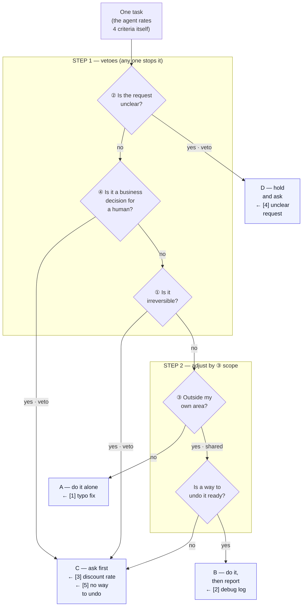
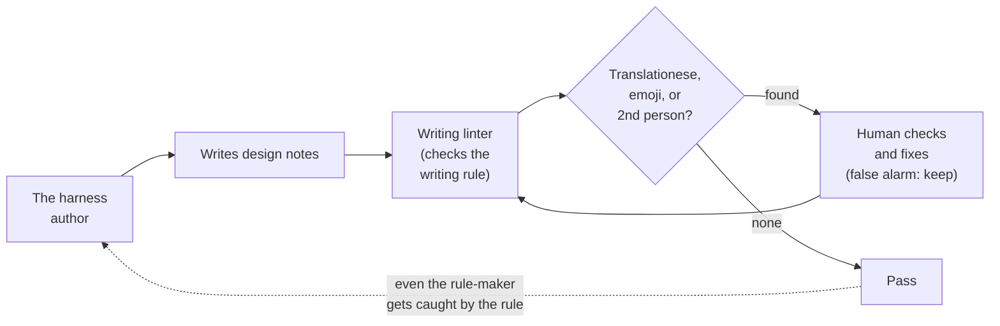

# Quickstart — feel it in ~5 minutes

[한국어](./QUICKSTART.md) · **English**

This harness checks whether an agent's result keeps the **whole** coherent — not just whether one task "succeeded." That value shows up inside a weeks-long project, so what follows is **two scenes you can run right now**, not a 5-minute summary of the whole thing.

- **Part 1 — run it:** a rule deciding "do it alone, or stop and ask?" in one command
- **Part 2 — see it:** the same discipline catching its own author

All you need is Python 3 (on Windows, `python` or `py` instead of `python3`). No plugin install is needed — a clone of the repository is enough.

---

## Part 1 — Run it: "do it alone, or stop and ask?"

A runnable example of the reversibility criteria ([design note 07](./design-notes/07-가역성분류표.md), Korean). When the agent meets a situation no rule covers, it rates four criteria:

- ① Can it be undone?
- ② Is the request clear?
- ③ Scope — is it inside my own area, or does it touch something shared?
- ④ Does it involve a business rule a human must decide?

Each situation lands on one of four outcomes: **A — do it alone** · **B — do it, then report** · **C — ask first** · **D — hold and ask**.

```sh
python3 examples/reversibility_demo.py
```

The demo prints in Korean (the rules are Korean canon). The five situations are:

| # | Situation | Outcome (printed label) |
|---|---|---|
| [1] | Fix a variable typo on my own feature branch | A — do it alone (`자율 실행`) |
| [2] | Add one debug log line to a shared utility | B — do it, then report (`사후 검수 + 알림`) |
| [3] | Put a 15% discount rate into the code | C — ask first (`사전 승인`), veto ④ |
| [4] | Implement an item the screen spec only describes as "handle that thing there" | D — hold and ask (`보류·질의`), veto ② |
| [5] | Bulk-insert sample data into a shared staging DB (no undo script yet) | C — ask first (`사전 승인`) |

```
[1] 내 feature 브랜치에서 변수 오타 수정
    가역성=가역 · 롤백=있음 · 기반정보=명확 · 영향범위=내 구역 · 업무규칙=해당없음
    → A 자율 실행   되돌릴 수 있고, 확실하고, 내 구역. 혼자 한다.

[2] 공용 유틸에 디버그 로그 한 줄 추가
    가역성=가역 · 롤백=있음 · 기반정보=명확 · 영향범위=외부·공유 · 업무규칙=해당없음
    → B 사후 검수 + 알림   외부·공유지만 되돌릴 수 있고 명확 → 하고 나서 알린다.

[3] 할인율을 15%로 코드에 반영
    가역성=가역 · 롤백=있음 · 기반정보=명확 · 영향범위=외부·공유 · 업무규칙=사업결정
    → C 사전 승인   ④ '사람이 정할' 사업 결정 (거부권) — 되돌릴 수 있어도 혼자 못 정한다.

[4] 화면설계서에 '거기 그거 처리'로만 적힌 항목 구현
    가역성=가역 · 롤백=있음 · 기반정보=모호 · 영향범위=외부·공유 · 업무규칙=해당없음
    → D 보류·질의   ② 뭘 하란 건지 모른다 (거부권) — 옆으로 치우고 다음 일부터.

[5] 공유 스테이징 DB에 샘플 데이터 일괄 삽입 (되돌리는 스크립트는 아직 없음)
    가역성=가역 · 롤백=없음 · 기반정보=명확 · 영향범위=외부·공유 · 업무규칙=해당없음
    → C 사전 승인   외부·공유인데 되돌릴 방법이 없다 → 보수적으로 멈추고 물어본다.
```

**Watch case [3].** Changing the discount rate is reversible and the request is clear — add up the points and you would say "safe, just do it." But a discount rate is a **business decision** for a human, so a single veto sends it to a human for approval instead of letting the agent go ahead on its own. Criteria ①②④ carry a veto: any one of them stops the task, no matter how the others look. The question is not "did the task succeed" but "does this decision keep the whole coherent."

The order of the check: the top box (the three vetoes) comes first; only what clears all three goes down to the ③ scope step.



### ...and it records *why* — so "checkable" is a record, not a promise

The gate doesn't stop at picking one of A to D; it leaves a record you can check later. Run case [3] through the skill with `--json`:

```sh
python3 skills/reversibility-gate/reversibility_gate.py \
  --task "할인율 15% 반영" --reversibility 가역 --rollback 있음 \
  --clarity 명확 --business 사업결정 --scope 외부공유 \
  --json --session demo --why-business "할인율은 기획이 정할 사업 규칙"
```

(The option values are Korean: `가역` reversible, `있음` present, `명확` clear, `사업결정` business decision, `외부공유` shared. The `--why-business` note says "the discount rate is a business rule for planning to decide.")

```json
{
  "종류": "가역성판정", "작업": "할인율 15% 반영", "결과": "C",
  "판정시각": "2026-11-14 17:33", "세션": "demo",
  "기준": {
    "가역성":   { "값": "가역", "롤백경로": "있음", "근거": "" },
    "기반정보": { "값": "명확", "근거": "" },
    "영향범위": { "값": "외부공유", "판정방식": "자가", "근거": "" },
    "업무규칙": { "값": "사업결정", "근거": "할인율은 기획이 정할 사업 규칙" }
  },
  "확신도": "보통", "거부권발동": "④", "보수조정": false,
  "결정근거": "④ '사람이 정할' 사업 결정 (거부권) — 되돌릴 수 있어도 혼자 못 정한다."
}
```

Later, a human (or, in the original project's full setup, a dedicated QA session such as `qa-master`) reads these records and catches "wait — that one was mine to decide," **not by re-reading the diff but from the gate's own evidence.** That is "keep the whole coherent, and make it checkable" as a real record.

> **Works now:** the routing, the one-step-more-cautious bump when confidence is low, and the recorded evidence above. **Not yet:** detecting ③ scope from the worktree automatically (the agent rates it itself for now), and moving the reversibility criteria into the formal rules in `rules/` (planned for 0.6.0, see the [roadmap](./design-notes/10-오케스트레이션-구성.md#10-버전-로드맵-020--100), Korean). Design: [`design-notes/07-가역성분류표.md`](./design-notes/07-가역성분류표.md) (Korean).

---

## Part 2 — See it: the same check, on its own author

The harness has a writing rule: no translationese, no emoji, no second-person address. Its author is not exempt — the rule's own linter runs on the design notes:

```sh
python3 skills/seosul-lint/seosul_lint.py design-notes/
```

```
design-notes/04-브랜치전략-이중실적장부.md:81 [번역투] "도장" → 확정(마일스톤 상태) / 표시(장부에 남기는 마크) ※맥락 따라
design-notes/05-검증-통합-릴리스결정.md:116 [번역투] "분배" → 나눠주기
...
```

While these notes were written, this linter caught translationese the author had missed, and the author fixed those spots. Running it now prints seventy-odd lines; most are places where the writing-rule document and the handover notes quote the banned words as examples. The two lines shown above were also checked by a human and kept: one is a deliberate gloss of an old word next to its replacement, the other is a substring of a longer word. The linter only finds; a human decides what to fix. The point is not "is this one output done" but "does it still fit the rules the whole is held to."



> This scene is the **writing-discipline** corner of the harness — next to full system coherence, not the same thing. It is shown because it is a real, checkable moment, not a staged one.

---

## Then what?

- **Use it in your project:** install it (see the [README](./README.en.md#install)), and `dlc-gate` (the skill that points to the right rule at each decision point) stops at the decision points a demo can't stage — before implementing, before committing, before something is written down as "verified."
- **Reading Korean?** The guidebook starts from the problem you are having: [`docs/guide/00-상황지도.md`](./docs/guide/00-상황지도.md). Chapter 9 comes with a merge demo (`bash examples/merge_break_demo.sh`): two branches that each pass on their own, merge without conflict, and then break together. Chapter 10 builds a decision survey from `examples/survey_demo.json`.
- **Splitting work across several Claude Code sessions?** Version 0.2.0 adds a **small mode** — the human decides, a gateway session relays and watches, worker sessions implement. See [`docs/overview-en.md`](./docs/overview-en.md#small-mode-020--multiple-sessions-without-the-full-setup) and the Korean setup guide [`docs/오케스트레이션-구성.md`](./docs/오케스트레이션-구성.md).

If it was worth trying, a star helps the next SI developer find it.
