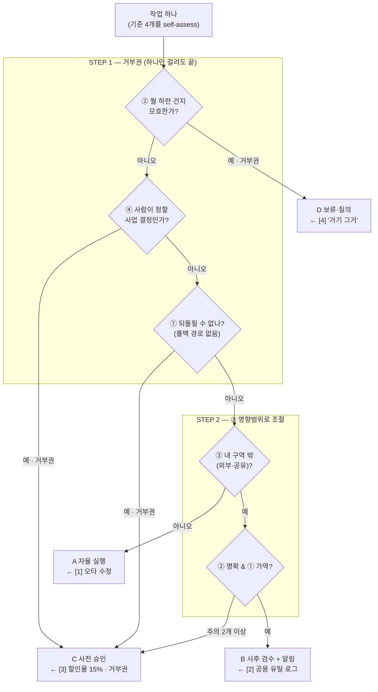
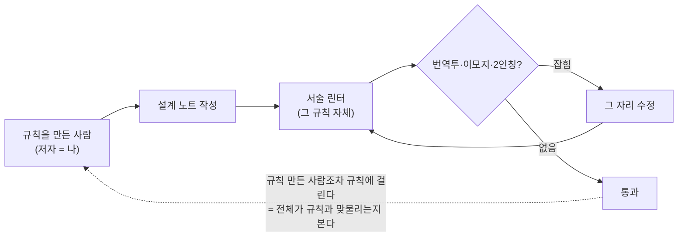

# Quickstart — feel it in ~5 minutes

This harness checks whether an agent's result keeps the **whole** coherent — not just whether one task "succeeded." That value really shows up inside a weeks-long project, so what follows is **two honest slices**, not a 5-minute summary of the whole thing.

- **Part 1 — run it** (a rule deciding, deterministically, in one command)
- **Part 2 — see it** (the same discipline catching its own author)

한국어 요약은 [맨 아래](#한국어).

---

## Part 1 — Run it: "do it alone, or stop and ask?"

A runnable slice of the reversibility rule ([07](./design-notes/07-가역성분류표.md)). It takes four everyday situations and routes each to one of four outcomes — **A** do it / **B** do it, then report / **C** stop and get approval / **D** hold, it's unclear.

```sh
python3 examples/reversibility_demo.py
```

```
[1] 내 feature 브랜치에서 변수 오타 수정
    가역성=가역 · 기반정보=명확 · 영향범위=내 구역 · 업무규칙=해당없음
    → A 자율 실행   되돌릴 수 있고, 확실하고, 내 구역. 혼자 한다.

[2] 공용 유틸에 디버그 로그 한 줄 추가
    가역성=가역 · 기반정보=명확 · 영향범위=외부·공유 · 업무규칙=해당없음
    → B 사후 검수 + 알림   외부·공유지만 되돌릴 수 있고 명확 → 하고 나서 알린다.

[3] 할인율을 15%로 코드에 반영
    가역성=가역 · 기반정보=명확 · 영향범위=외부·공유 · 업무규칙=사업결정
    → C 사전 승인   ④ '사람이 정할' 사업 결정 (거부권) — 되돌릴 수 있어도 혼자 못 정한다.

[4] 화면설계서에 '거기 그거 처리'로만 적힌 항목 구현
    가역성=가역 · 기반정보=모호 · 영향범위=외부·공유 · 업무규칙=해당없음
    → D 보류·질의   ② 뭘 하란 건지 모른다 (거부권) — 옆으로 치우고 다음 일부터.
```

**Watch case [3].** It is reversible, clear, and looks like "your call" — add up the points and you'd say "safe, just do it." But setting a discount rate is a **business decision**, so a single veto stops it. That is the whole idea: not "did the task succeed," but "does this decision keep the whole coherent." **Points can't outvote a veto.**

How the four land (top box = the three vetoes; only what clears them drops to the ③ adjust step):



> This is one runnable slice of rule 07, not the whole harness. The full router (confidence, recorded evidence for after-the-fact audit) is deliberately deferred — see [`design-notes/07-가역성분류표.md`](./design-notes/07-가역성분류표.md).

---

## Part 2 — See it: the same check, on its own author

The harness has a writing rule (no translationese, no emoji, 1st person). Its author is not exempt — the rule's own linter runs on the design notes:

```sh
python3 skills/seosul-lint/seosul_lint.py design-notes/
```

```
design-notes/04-브랜치전략-이중실적장부.md:81 [번역투] "도장" → 확정 / 표시
design-notes/05-검증-통합-릴리스결정.md:116 [번역투] "분배" → 나눠주기
...
```

While these notes were written, this linter caught translationese the author had missed, and those spots were fixed. The rule-maker gets caught by the rule. That is the shape of the whole thing: not "this one output is done," but "does it still fit the rules the whole is held to."



> This slice is the **writing-discipline** corner of the harness — adjacent to, not the same as, full system coherence. It is shown because it is a real, verifiable moment, not a staged one.

---

## Then what?

The real thing lives in your project: install it (see the [README](./README.md)), and `dlc-gate` stops you at the decision points a demo can't stage — before implementing, before committing, when something is about to be marked "verified."

If the dog food was edible, a star helps the next SI developer find it.

---

## 한국어

- **1부 — 돌려보기:** `python3 examples/reversibility_demo.py` — 가역성 규칙(07)이 상황 4개를 "혼자 함(A) / 하고 알림(B) / 멈추고 승인(C) / 보류(D)"로 판정한다. **[3]이 핵심** — 가역·명확·내 일처럼 보여도 '할인율'은 사업 결정이라 거부권으로 멈춘다. 점수로 못 덮는다.
- **2부 — 보기:** `python3 skills/seosul-lint/seosul_lint.py design-notes/` — 규칙을 만든 사람이 놓친 번역투를 그 규칙의 린터가 잡는다. 규칙 만든 사람조차 규칙에 걸린다.
- 둘 다 **한 조각**이지 하네스 전체의 5분 요약이 아니다. 전체는 네 실제 프로젝트에서 게이트가 제때 멈춰 세울 때 드러난다.
