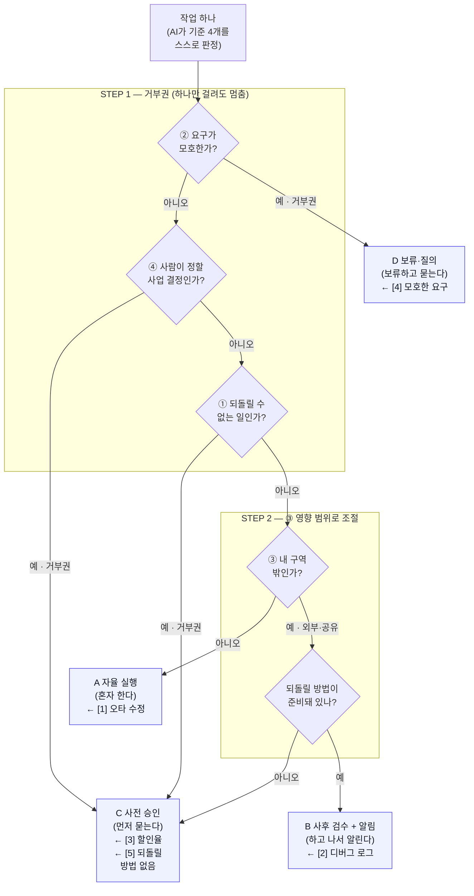
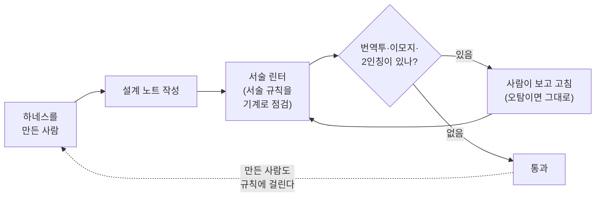

# 5분 맛보기 — 직접 실행해 보기

**한국어** · [English](./QUICKSTART.en.md)

이 하네스는 에이전트의 결과가 작업 하나의 성공에 그치지 않고 **전체**와 맞물리는지 확인합니다. 그 쓸모는 몇 주짜리 프로젝트 안에서 드러나기 때문에, 아래는 하네스 전체를 5분에 요약한 것이 아니라 지금 바로 실행해 볼 수 있는 **두 장면**입니다.

- **1부 — 실행해 보기:** 규칙이 "혼자 해도 되나, 멈추고 물어야 하나"를 명령 하나로 판정하는 장면
- **2부 — 보기:** 같은 규율이 규칙을 만든 사람의 글을 잡아내는 장면

필요한 것은 Python 3뿐입니다(Windows에서는 `python3` 대신 `python`이나 `py`). 플러그인을 설치하지 않아도, 저장소를 복제하기만 하면 실행할 수 있습니다.

---

## 1부 — 실행해 보기: "혼자 해도 되나, 멈추고 물어야 하나"

가역성 기준([설계 문서 07](./design-notes/07-가역성분류표.md))을 실행해 볼 수 있게 만든 예제입니다. AI가 규칙에 정해 두지 않은 새 상황을 만났을 때, 다음 기준 4개로 판정합니다.

- ① 되돌릴 수 있나
- ② 요구가 명확한가
- ③ 영향 범위(내 구역 안의 일인가, 남과 함께 쓰는 곳에 닿는가)
- ④ 사람이 정할 업무 규칙과 관련 있나

판정 결과는 넷 중 하나입니다. **A 자율 실행**(혼자 한다) · **B 사후 검수 + 알림**(하고 나서 알린다) · **C 사전 승인**(먼저 묻는다) · **D 보류·질의**(보류하고 묻는다).

```sh
python3 examples/reversibility_demo.py
```

```
[1] 내 feature 브랜치에서 변수 오타 수정
    가역성=가역 · 롤백=있음 · 기반정보=명확 · 영향범위=내 구역 · 업무규칙=해당없음
    → A 자율 실행   되돌릴 수 있고, 확실하고, 내 구역. 혼자 한다.

[2] 공용 유틸에 디버그 로그 한 줄 추가
    가역성=가역 · 롤백=있음 · 기반정보=명확 · 영향범위=외부·공유 · 업무규칙=해당없음
    → B 사후 검수 + 알림   외부·공유지만 되돌릴 수 있고 명확 → 하고 나서 알린다.

[3] 할인율을 15%로 코드에 반영
    가역성=가역 · 롤백=있음 · 기반정보=명확 · 영향범위=외부·공유 · 업무규칙=사업결정
    → C 사전 승인   ④ '사람이 정할' 사업 결정 (거부권) — 되돌릴 수 있어도 혼자 못 정한다.

[4] 화면설계서에 '거기 그거 처리'로만 적힌 항목 구현
    가역성=가역 · 롤백=있음 · 기반정보=모호 · 영향범위=외부·공유 · 업무규칙=해당없음
    → D 보류·질의   ② 뭘 하란 건지 모른다 (거부권) — 옆으로 치우고 다음 일부터.

[5] 공유 스테이징 DB에 샘플 데이터 일괄 삽입 (되돌리는 스크립트는 아직 없음)
    가역성=가역 · 롤백=없음 · 기반정보=명확 · 영향범위=외부·공유 · 업무규칙=해당없음
    → C 사전 승인   외부·공유인데 되돌릴 방법이 없다 → 보수적으로 멈추고 물어본다.
```

(출력의 "기반정보"는 ② 요구가 명확한가, "롤백"은 되돌리는 방법이 준비돼 있는가입니다.)

**[3]번을 보세요.** 할인율을 바꾸는 코드는 되돌릴 수 있고 요구도 명확합니다. 점수를 더하면 "안전하니 해도 된다"가 나올 상황입니다. 하지만 할인율은 사람이 정할 **사업 결정**이라, 거부권 하나에 걸려 사람의 승인을 받으러 갑니다. 기준 ①②④는 거부권이 있어서, 하나만 걸려도 다른 기준이 모두 괜찮은 것과 상관없이 멈춥니다. 이 하네스가 보는 것은 "작업이 성공했나"가 아니라 "이 결정이 전체와 맞는가"입니다.

판정 순서는 이렇습니다. 위 상자(거부권 셋)를 먼저 보고, 셋을 모두 통과한 일만 아래 ③ 영향 범위로 조절합니다.



### 판정 근거도 남긴다 — "확인할 수 있다"를 기록으로

판정 도구는 A~D 가운데 하나를 고르는 데서 끝나지 않고, 나중에 다시 확인할 수 있는 **판정 근거**를 남깁니다. [3]번을 스킬에 `--json`으로 넣어 보면 이렇습니다.

```sh
python3 skills/reversibility-gate/reversibility_gate.py \
  --task "할인율 15% 반영" --reversibility 가역 --rollback 있음 \
  --clarity 명확 --business 사업결정 --scope 외부공유 \
  --json --session demo --why-business "할인율은 기획이 정할 사업 규칙"
```

```json
{
  "종류": "가역성판정", "작업": "할인율 15% 반영", "결과": "C",
  "판정시각": "2026-11-14 17:33", "세션": "demo",
  "기준": {
    "가역성":   { "값": "가역", "롤백경로": "있음", "근거": "" },
    "기반정보": { "값": "명확", "근거": "" },
    "영향범위": { "값": "외부공유", "판정방식": "자가", "근거": "" },
    "업무규칙": { "값": "사업결정", "근거": "할인율은 기획이 정할 사업 규칙" }
  },
  "확신도": "보통", "거부권발동": "④", "보수조정": false,
  "결정근거": "④ '사람이 정할' 사업 결정 (거부권) — 되돌릴 수 있어도 혼자 못 정한다."
}
```

나중에 사람(원본 사업의 전체 구성인 완전형이라면 `qa-master` 같은 전용 QA 세션)이 이 기록을 읽고 "이건 내가 정할 일이었는데"를 알아챕니다. 변경 내용을 처음부터 다시 읽지 않고, 판정이 남긴 근거만으로 알 수 있습니다. "전체와 맞는지 확인하고, 그 확인을 다시 따라갈 수 있게 한다"는 약속이 실제 기록으로 남는 것입니다.

> 지금 되는 것: 판정 순서, 확신도가 '낮음'이면 한 단계 보수적으로 판정하기, 위의 판정 근거 기록. 아직 안 된 것: ③ 영향 범위를 워크트리에서 자동으로 알아내기(지금은 AI가 스스로 판정), 가역성 기준을 정식 규칙(`rules/`)으로 넣기(0.6.0 예정, [로드맵](./design-notes/10-오케스트레이션-구성.md#10-버전-로드맵-020--100)). 설계는 [`design-notes/07-가역성분류표.md`](./design-notes/07-가역성분류표.md).

---

## 2부 — 보기: 규칙을 만든 사람에게도 같은 점검

하네스에는 서술 규칙이 있습니다. 번역투·이모지·2인칭 호칭을 쓰지 않는다는 규칙입니다. 규칙을 만든 사람도 예외가 아니라서, 설계 노트도 그 규칙의 린터로 점검합니다.

```sh
python3 skills/seosul-lint/seosul_lint.py design-notes/
```

```
design-notes/04-브랜치전략-이중실적장부.md:81 [번역투] "도장" → 확정(마일스톤 상태) / 표시(장부에 남기는 마크) ※맥락 따라
design-notes/05-검증-통합-릴리스결정.md:116 [번역투] "분배" → 나눠주기
...
```

설계 노트를 쓰는 동안 이 린터가 작성자가 놓친 번역투를 잡아냈고, 작성자가 그 자리를 고쳤습니다. 지금 실행하면 70건 남짓이 나오는데, 대부분은 서술 규칙 문서와 인계 문서가 금칙어를 예로 든 곳입니다. 위에 옮긴 두 줄도 사람이 확인하고 그대로 둔 것입니다. 04는 바꾼 말 옆에 원래 말을 일부러 함께 적은 곳이고, 05는 두 낱말("부분", "배포")을 붙여 쓴 말에서 가운데 두 글자가 사전 단어로 잡힌 것입니다. 린터는 찾기만 하고, 고칠지는 사람이 정합니다. 결과물 하나가 끝났는지가 아니라, 전체가 지키기로 한 규칙과 여전히 맞는지를 봅니다.



> 이 장면은 하네스의 서술 규율 쪽입니다. 시스템 전체의 정합성과 같은 것은 아니고, 그 옆에 있는 규율입니다. 꾸민 장면이 아니라 실제로 확인할 수 있는 장면이라 보여 드립니다.

---

## 다음은

- **내 프로젝트에서 쓰기:** 설치하면 `dlc-gate`(결정 지점마다 맞는 규칙을 안내하는 스킬)가 예제로는 보여 줄 수 없는 결정 지점(구현 전, 커밋 전, "검증 완료"라고 적기 전)마다 작업을 멈추고 확인을 받습니다. 설치는 [README](./README.md#설치).
- **겪는 문제로 찾기:** [상황 지도](./docs/guide/00-상황지도.md)(AI를 쓰다 겪는 문제로 찾는 안내서). 9장에는 각자 통과한 두 브랜치가 충돌 없이 합쳐진 뒤 깨지는 예제(`bash examples/merge_break_demo.sh`)가, 10장에는 사람에게 물을 결정을 설문 하나로 만드는 예제(`examples/survey_demo.json`)가 있습니다.
- **여러 세션으로 나눠 쓰기(0.2.0, 소규모 모드):** 사람(결정) → 게이트웨이 세션(전달·감시) → 실무자 세션(구현). 안내서는 [`docs/오케스트레이션-구성.md`](./docs/오케스트레이션-구성.md).

써 보고 쓸 만했다면, 별 하나가 다음 SI 개발자가 이 저장소를 찾는 데 도움이 됩니다.
