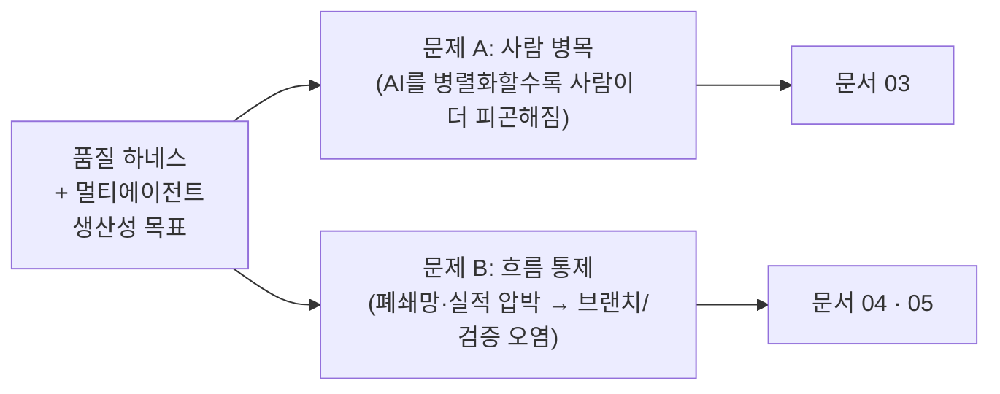
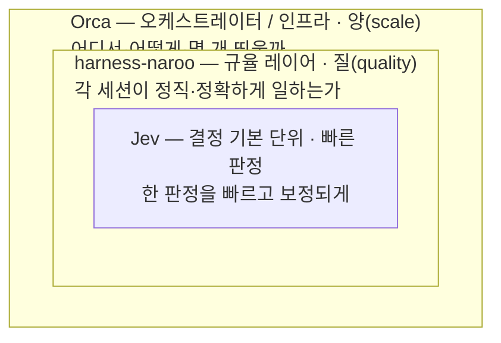
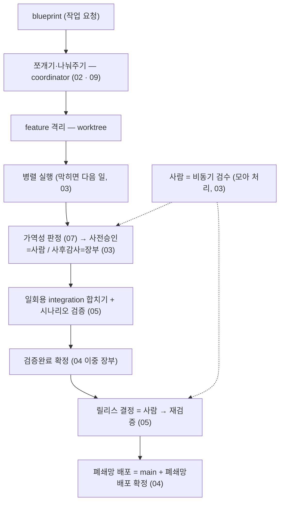

# 하네스 진화 설계 노트 — 인덱스

> 2026-11-09, master(Opus)와의 설계 대화를 항목별로 정리.
> 목적: 읽고 **"어느 방향이 내가 원하는 것에 가까운가"**를 고민하기 위한 자료.
> 이 폴더는 하네스 **다음 버전 설계 노트**입니다(공개 레포에 포함). 1인칭 "내" = 사용자(백가희).

---

## 출발점

"내 하네스(harness-naroo)와 [stablyai/orca](https://github.com/stablyai/orca)의 차이는?"라는
질문에서 시작해, **"품질을 위해 만들었지만 결국 멀티에이전트로 생산성도 올리고 싶다"**는
본래 목표로 이어졌고, 실제 SI 프로젝트(S 차세대, 폐쇄망)에서 겪은 문제를 되짚으며
하네스의 다음 버전 설계로 수렴했다.

## 이 대화가 드러낸 큰 그림

내 하네스는 두 개의 서로 다른 문제를 동시에 안고 있었고, 각각 다른 해법이 필요하다.

*그 위에: 포지셔닝(01·02) — 이 하네스가 왜 남다른가 · 그 뒤에: 확장 전략(06) — 이 프로젝트용 → 범용 하네스*

## 포지셔닝 — 셋은 경쟁이 아니라 스택

*바깥일수록 여럿 쓰기 · 안쪽일수록 정확히 결정하기*
내 하네스는 Orca 위에서 동작하고, Jev를 안에 품을 수 있는 **중간 레이어**다. (상세: 문서 01)

> **비유 등장인물** (문서 전반에서 "쉬운 예로/비유하자면"으로 등장): 알바생 = AI · 사장님 = 사람(나) ·
> 가게 = 프로젝트 · 손님상 = 배포 · 공용 작업대 = main · 임시 작업대 = integration.

## 전체 작동 루프 (CE — 조각이 어떻게 맞물리나)

02(쪼개기·나눠주기)·03(사람·게이트)·04(장부·배포)·05(통합·결정·재검증)·07(가역성)이 하나의 운영 루프로 맞물려 동작한다.

*격리 → 쪼개기·나눠주기 → 실행(막히면 다음 일) → [게이트] → 일회용 합치기·검증(확정) → 결정 → 재검증 → 배포=main. 사람은 전 구간을 **비동기로(모아 처리)** 검수.*

## 문서 목록 (권장 읽기 순서)

| # | 제목 | 핵심 한 줄 |
|---|---|---|
| 01 | [**포지셔닝 — Orca · Jev**](./01-포지셔닝.md) | Orca=AI를 여럿 쓰게 하는 인프라(담는 그릇) · Jev=빠른 결정 모델(꽂는 부품) · 내 건 그 사이 **규율**. 셋은 스택. |
| 02 | [멀티에이전트 — 빠진 조각](./02-멀티에이전트-빠진조각.md) | 협업 기반은 이미 60% 있고, 없는 건 디스패치·통합 로직. (단 03에서 우선순위가 뒤집힘) |
| 03 | [사람 병목과 비동기 검수 루프](./03-사람병목-비동기검수.md) | 진짜 병목은 작업 나눠주기가 아니라 **사람 검수 처리량**. 사람을 동기 감시자→비동기 검수자로. |
| 04 | [브랜치 전략과 이중 실적 장부](./04-브랜치전략-이중실적장부.md) | 세 상태가 뭉개졌고 보상이 마지막 하나에만 걸림 → 오염은 합리적 반응. 인센티브부터 고친다. |
| 05 | [검증·통합·릴리스 결정](./05-검증-통합-릴리스결정.md) | 시나리오 검증은 통합을 강제한다. 빠진 역할은 **일회용 integration 브랜치**. |
| 06 | [두 하네스 — 핵심과 환경값](./06-두하네스-핵심과환경값.md) | 구체(폐쇄망)본 먼저 → 환경 파라미터를 들어내 범용본 추출. |
| 07 | [가역성 분류표](./07-가역성분류표.md) | "혼자 할까 / 물어볼까"를 정하는 기준 문서. 거부권은 점수로 상쇄되지 않는다. 결과 4가지 + 기준 4가지 + 판정 근거 JSON. 03·02의 공통 잣대. |
| 08 | [**서술 규칙 (정본)**](./08-서술규칙.md) | 내 산출물의 서술 방식 정본 — 원칙·시점·표기·용어대치(T1)·번역투(T2)를 묶음. |
| 09 | [coordinator (쪼개기·나눠주기)](./09-coordinator.md) | blueprint를 독립 단위로 쪼개 유휴 에이전트에 나눠주는 엔진. 쪼개기는 정보 명확할 때만(02 #3). (T3) |
| 10 | [**오케스트레이션 구성 (0.2.0)**](./10-오케스트레이션-구성.md) | 여러 세션을 엮는 구성. 최소 모드 = 3단 구조(사람→게이트웨이→실무자) + 인프라 "갖춤/면제". D-1~D-5 처분, **② 좁은 위임·D-5 워커 루트 개밥 검증 통과**(부록 B·C·D), **스케일 개밥(실무자 3명, PR·병합·정리까지) 부록 E-1~E-8** — E-7에 자기 채점 범위와 충돌 판정 규칙 후보. (T8) |

**쉬운 예시:** 별도 쉬운말 파일은 없앴고, 각 문서에 **"비유하자면/쉬운 예로" 끼움 레이어**로 통합했다. (등장인물: 위 "비유 등장인물" 참조.)
**다이어그램:** [`diagrams/`](./diagrams/) — Mermaid SVG 9개(스택·큰그림·맨vs하네스·사전vs사후·통합흐름·릴리스결정·작동루프·가역성판정흐름·실전검증루프).

**실행물 (실행되는 것):** 설계 노트의 규칙이 실제로 실행되는 조각들 — 레포 루트 [`QUICKSTART.md`](../QUICKSTART.md)(5분 입구) · `examples/reversibility_demo.py`(07 라우터 데모) · 공개 스킬 `skills/reversibility-gate`(07 판정 + 근거 JSON)·`skills/seosul-lint`(서술 린터, 08).

**작업 기록 (`tasks/`):** 하네스에 스킬·규칙을 더하는 작업마다 폴더 하나에 청사진(`blueprint.md`)과 완료보고서(`completion-report.md`)를 둔다. 규칙 CM-02는 완료보고서를 커밋하지 않는다고 정하지만, 이 저장소의 `tasks/`는 하네스 범용화의 이력이라 예외로 커밋한다(2026-11-20 사용자 결정). 현재: [`server-ops`](./tasks/server-ops/blueprint.md) · [`survey-gen`](./tasks/survey-gen/blueprint.md) (둘 다 2026-11-20 승인·구현). 출시 점검표: [`release-0.2.0/checklist.md`](./tasks/release-0.2.0/checklist.md)(관문 4개, 관문 2는 `tools/release_check.py`).

**공개 가이드 (소비자용, `docs/`):** [`환경값-정의.md`](../docs/환경값-정의.md)(규칙의 환경값을 내 것으로 바꿔 읽는 법, 06) · [`오케스트레이션-구성.md`](../docs/오케스트레이션-구성.md)(소규모 모드 세팅 네 걸음 + 선택형 좁은 위임, 10) · [`위임기록-템플릿.md`](../docs/위임기록-템플릿.md)(10 부록 A의 공개본) · [`overview-en.md`](../docs/overview-en.md)(영문 개요).

**방법 문서 (주제 무관·재사용):**

| 문서 | 핵심 한 줄 |
|---|---|
| [쉬운 글쓰기 기준](./쉬운-글쓰기-기준.md) | 어려운 문서를 "중학생도 이해"로 다시 쓸 때의 재사용 체크리스트 + 용어 치환 사전. |
| [번역투 교정 사전](./번역투-교정사전.md) | AI가 자주 쓰는 어색한 한국어(번역투)를 자연스럽게. T1(난이도)과 다른 "자연스러움" 갈래. (T2) |
| [열린 논제(backlog)](./논제-backlog.md) | 나중에 다룰 주제. 현재: **T1 용어 대치 기준(문서 08)** · **T2 번역투 교정**. |

## 지금 테이블에 올라온 "만들 것" 후보 (중복 포함)

대화 중 반복해서 수렴한 설계 조각들. 각 문서의 "내가 정할 것"에서 더 구체화된다.

1. **비동기 검수 루프** — 제쳐-당김 + 사후감사 + 이중 실적 장부 (문서 03·04)
2. **브랜치·릴리스 규칙(BR)** — 격리→일회용 합치기→검증→결정→재검증→배포=main (문서 04·05)
3. **통합/머지 게이트** — 1·2의 공통 기술 절반 (문서 02·05)
4. **coordinator(작업 쪼개기·나눠주기)** — 문서 02. *단, 문서 03에서 "이게 1순위는 아니다"로 조정됨.*

## 내가 전체 차원에서 정할 것

- **A. 어느 문제가 먼저인가?** 사람 병목(03)인가, 흐름 통제(04·05)인가.
  - 나의 회고("최종 검수자인 나는 여전히 피곤했다")는 A쪽(사람)을 가리키지만,
  - "main에 다 병합해버린 사고"는 B쪽(흐름)이 더 구체적 피가 흐른 지점.
- **B. 이번 라운드의 산출물 형태?** 실행 가능한 스킬/규칙(코드)인가, 방법론 문서인가, 둘 다인가.
- **C. 구체본(S)을 먼저 완성할까, 처음부터 범용본을 노릴까?** (문서 06 권장: 구체 먼저)

## 1차 검토(2026-11-09) 반영 — 핵심 두 가지

- **[#3] "질 vs 양"은 전면 택일이 아니다.** 자율 병렬화는 **기반 정보의 완전성**이 전제다
  (불완전한 정보 위 병렬화 = 모호함을 N번 잘못 넘겨짚음). → **영역별로 나누는** 문제:
  정보 명확한 영역은 병렬·자율, 모호한 영역은 Human Gate 유지. (상세: 문서 02)
- **[#5·#7] 다음 산출물 1순위 후보 두 개가 떠올랐다:**
  - **가역성 분류표** — 선택적 비동기 게이트의 "선택 기준". 방법 B의 기준선. (문서 03)
  - **git-deploy-extractor ↔ 브랜치 모델** — 실제 배포 함정을 구조적으로 해결하는 짝. (문서 05)
- 채택 확정: **풀 큐+락**(#4). 비유 확정: **Orca=조직 / 하네스=개인**(#2, 문서 01).

## 2차 검토 반영 — 방향 결정

- **[01] "질이냐 양이냐" 결론:** 질을 깔고 **질 안 깨지는 만큼 양.** 단계적 —
  ①하네스(독립 사용 가능) → ②**"규칙을 아는" 오케스트레이터**(Orca와 차별). 병렬화는 규칙 게이트를 존중.
- **[01] "혼자 해도 되는 기준":** **규칙이 제어를 쥔다**(투명한 규율). Jev류는 기준을 대체 않고 **속도 보조**로만.
- **[04] 확정 두 번 채택 + "검수 두 곳":** 공장 QC(검증완료) + **식당 주방 검수**(릴리스 재검증, 식당의 의무).
  "검증완료 ≠ 바로 써도 됨" → 문서 04·05가 한 그림. ✓ **`main` = "손님상에 나간 것만" 확정.**
- **[05 맹점] 상차림 얽힘:** "모 아니면 도"가 아니라 **6단계 스펙트럼(O1~O6)** + **측정 질문 5개(Q1~Q5)** +
  **시간 상한**으로 병목 방지.
- **[05 정리]** 04 확정 덕에: integration = **기본 통째 + 공유 로직만 하나씩 먼저**,
  재검증 = **변경 + 여파 범위 + 기본 한 바퀴**. (기존 조각의 조합)
- **[01] 공개 표기:** README엔 **Orca 이름 안 댐**(긍정형 자기소개만). 혼자 판정 기준은 **규칙이 쥠**.
