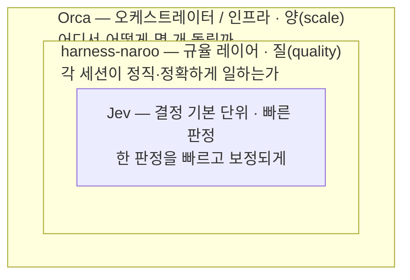

# 01 — 포지셔닝: harness-naroo vs Orca · Jev

> **핵심 한 줄:** 내 하네스는 "에이전트를 **제대로** 돌리는 규칙 체계".
> **Orca**는 "**많이** 돌리는 인프라/앱"(담는 그릇), **Jev**는 "**빠르고 보정된** 결정 모델"(안에 꽂는 부품).
> 셋은 경쟁이 아니라 **스택**을 이룬다.

---

## 셋은 스택을 이룬다 (큰 그림)

*바깥일수록 많이 돌리기 · 안쪽일수록 정확히 결정하기*

| 레이어 | 정체 | 핵심 질문 | 비유 |
|---|---|---|---|
| **Orca** (바깥) | 인프라·오케스트레이터 | "어디서·몇 개 돌릴까?" | 알바생 여럿 돌리는 **회사·작업장** |
| **harness-naroo** (가운데) | 규율 프로세스 | "각자 제대로·정직하게?" | **업무규정**을 지키는 직원 규율 |
| **Jev** (안) | 결정 기본 단위 | "이 판정을 빠르게?" | 0.1초에 답하는 **계산기 부품** |

내 하네스는 Orca 위에서 돌고, Jev를 안에 품을 수 있는 **중간 레이어**다. 아래에서 Orca(그릇)·Jev(부품)와 각각 어떻게 다른지 본다.

---

## 누구를 위한 것인가 — 첫 고객과 한 방

**첫 고객:** SI 개발자 — 자연히 한국어로 일하는 사람 — 중에서, 다음 믿음에 동의하고 **실제로 그걸 하려는** 사람.

> "에이전트 하나가 작업에 성공했냐가 끝이 아니라, 그 결과가 **전체 개발 프로세스·시스템의 정합성**을 지키는지까지 확인할 수 있어야 한다."

(Claude Code 파워유저는 기준이 모호해 표적에서 뺀다. 폐쇄망은 별개 문제로 분리.)

**한 방(왜 특별한가):** 요즘 에이전트 도구 대부분은 "이 작업 하나 잘 됐나"에 맞춰져 있다. 이 하네스는 **"그 작업이 전체를 안 깨뜨렸나"**를 본다 — 개별 성공이 아니라 **정합성.** 이걸 대놓고 내건 도구는 드물다. 그래서 이게 공개 README 맨 앞 한 줄이 된다.

**이 표적이 곧 '칼'이다** (그러모은 것 → 제품):
- **앞세울 것:** 규칙 정본을 그 순간 확인시키는 dlc-gate · 결과 재검증·시나리오(04·05) · 혼자 할지 물어볼지 경계 긋는 07 · 정보 명확한 곳만 병렬화(02). = "규칙을 아는 오케스트레이터" 철학.
- **뒤로 뺄 것(이 고객엔 곁가지):** 특정 모노레포용 worktree·sparse, java 전용 memcheck, AG-15 장부 세부 — 참고로만.
- **아직 약한 것:** "5분 안에 가치가 보이는 입구." 정합성 확인은 5분에 보여주기 어려운 값이라, v1까지 숙제로 남는다.

**지금 레포엔 이 물건이 이미 다 들어 있다** — 게이트·재검증·07·규율 철학이 전부 "전체 정합성 유지" 장치다. 다만 이 한 가지 약속으로 **묶어 내건 적이 없었을 뿐.** 묶는 것이 "좋은 걸 그러모아 놓기만 한 상태"를 제품으로 바꾼다.

---

## vs Orca — "담는 그릇" (인프라)

### Orca란 (요약)
- 오픈소스(MIT) **데스크톱/모바일 앱**. 태그라인 "The AI Orchestrator for 100x builders".
- Claude Code·Codex 같은 CLI 코딩 에이전트를 **병렬로 다수 실행**, 각자 git 워크트리에 격리.
- 코디네이터 에이전트가 큰 작업을 쪼개 워커에 나눠줌, 결과 수집.
- Run Anywhere(원격 서버·SSH·클라우드 VM), 폰 앱으로 알림·응답, diff 리뷰, CI 실패 되돌림.
- 설치: `brew install --cask stablyai/orca/orca`, 앱 다운로드.

### 대비표
| | **harness-naroo (내 것)** | **stablyai/orca** |
|---|---|---|
| 정체 | Claude Code **플러그인**(규칙·게이트·스킬) | **앱**(에이전트 오케스트레이터) |
| 핵심 질문 | "AI가 **제대로** 일하게 하려면?" | "AI를 **많이** 돌리려면?" |
| 비유 | 팀의 **업무규정·QA 프로세스** | 여러 작업자를 돌리는 **오케스트레이터·작업장** |
| 형태 | 텍스트(규칙 md) + stdlib 파이썬 스킬 | Electron 앱 + CLI + 클라우드 VM + 폰 앱 |
| 해결 방향 | **질(discipline)** | **양(scale)** |
| 설치 | `/plugin install` (Claude Code 안) | `brew install` / 앱 |

> 비유하자면, Orca는 **알바생(AI)을 많이 뽑아 돌리는 회사**(많이 돌리기 전문), 내 하네스는
> 그 알바생 한 명이 **제대로 일하게 하는 규율**(제대로 하기 전문)이다.

### 결이 다른 지점
- **문제의 방향이 반대.** Orca는 양 문제(100개 에이전트가 안 부딪히게, 자는 동안도 돌게).
  나는 질 문제(넘겨짚지 않게, 검증 안 한 걸 검증됐다 안 하게, 승인 없이 구현 안 하게).
- **운영 철학이 반대.** Orca는 자율성·병렬성 극대화. 나는 경계·승인 게이트로 **의도적으로 제약**.
  CM-11(귀속 금지), GT-02(승인 전 구현 금지), AG-15(대기 장부)는 Orca에 대응물이 없다.
- **겹치는 부분(얇게):** 워크트리 격리, 세션 간 협업. 다만 Orca는 앱이 자동 관리,
  나는 규칙(WT)과 스킬로 사람이 통제.

### 경쟁이 아니라 보완
Orca는 **인프라**, 내 하네스는 그 위에 얹는 **규율 레이어**.
극단적으로, *Orca 안에서 돌아가는 각 Claude Code 세션에 내 플러그인을 깔 수도* 있다.
Orca가 "어디서 어떻게 돌릴까"를, 내 규칙이 "그 각각이 정직하게 일하는가"를 맡는 구조.

> 비유하자면, Orca = **회사라는 조직**, 내 하네스 = **직원 개인**. 회사는 많은 직원을 고용·배치·관리하지만,
> "그 직원 한 명이 성실하고 정직하게 일하는가"는 조직도가 보장하지 않는다 — 그건 **개인의 규율**이다.
> 좋은 회사일수록 규율 있는 직원이 필요하듯, 둘은 서로를 **요구**한다.
> (심지어 Orca가 돌리는 세션 하나하나에 내 규칙을 깔 수도 있다.)

---

## vs Jev — "꽂는 부품" (결정 모델)

참고: [introducing-system-one-models-and-jev](https://typesafe.ai/blog/introducing-system-one-models-and-jev)

Jev는 Orca와 또 다른 층위다 — 앱/인프라가 아니라 **AI 모델 자체**(구조화된 결정 기본 단위).
내 하네스와는 더 멀면서(모델 vs 프로세스) 동시에 더 흥미롭게 맞물린다 —
**Jev는 하네스를 담는 그릇이 아니라, 하네스 안에 꽂을 부품(organ)이 될 수 있다.**

### Jev란 (요약)
- **System One 모델** 클래스의 첫 모델. 이름부터 Kahneman의 **System 1**(빠르고 반사적인 직관) 암시.
- 채팅/텍스트 생성이 아니라 **"구조화된 결정"**을 내는 모델.
  슬로건: *"비정형 상태 입력 → 타입이 박힌 확률적 결정 출력" — 프론티어 지능을 함수 호출처럼.*
- 자유 문자열 생성을 **포기**하고, 미리 정의한 스키마로만 출력 + **보정된(calibrated) 확신도.**
  (RLCD — Reinforcement Learning for Calibrated Decisions)
- 용도: 분류·라우팅·점수화·추출·분기("똑똑한 if문"), LLM 출력/추론/프롬프트 **가드레일**(탈옥 탐지 등).
- 세일즈 포인트: 70~500ms, 매우 저렴(입력 $0.042/M, 출력 무료), **스키마 위반(타입 에러) 수학적으로
  불가능 · "환각 불가" · 과신하지 않는 보정된 확신도.**

> 쉬운 예로, Jev는 글 쓰는 AI가 아니라 묻는 말에 **0.1초에 '네/아니오/몇 점'** 답하는 **계산기 부품**이다.
> 내 하네스를 **담는 그릇(Orca)이 아니라, 하네스 안에 꽂는 부품**.

### 대비표
| | **harness-naroo (내 것)** | **Jev** |
|---|---|---|
| 정체 | **방법론/규율 레이어**(규칙·게이트·스킬) | **AI 모델**(결정 기본 단위) |
| 층위 | 에이전트를 **둘러싸는 프로세스** | 에이전트 **안에 꽂히는 부품** |
| 사고 유형 | **System 2**(숙고·다단계 구현·게이트) | **System 1**(빠른 반사 결정) |
| 신뢰성 확보 | **프로세스**로(게이트·검증·장부) — 모델은 틀릴 수 있다고 전제 | **모델**에 내장(타입·보정 확신도) |
| 출력 | 실제 작업(코드·문서·협업) | 타입 박힌 결정 1개 |
| 환각 대응 | "검증됨=정말 검증됨" 규칙으로 **사후 적발** | 스키마로 **구조적 차단**(단, 스키마 준수에 한정) |

### 결이 다른 지점
- **Jev는 "결정 부품", 나는 "작업 프로세스".** Jev는 코드를 짜주지도, 세션을 엮지도,
  브랜치를 관리하지도 않는다. 하나의 결정을 빠르고 보정되게 내뱉을 뿐. **하네스를 대체할 수 없다.**
- **신뢰성의 메커니즘이 정반대.** Jev는 신뢰성을 **모델에 굽고**(can't hallucinate),
  나는 **프로세스로 감싼다**(틀릴 수 있는 모델 위에 게이트·장부).
  Jev의 "환각 불가"는 *스키마 준수*에 한정 — "에이전트가 **한다고 한 걸 실제로 했는가**"
  (프로세스 정직성)는 Jev가 검증 못 한다. 그건 테스트 실행·장부 대조가 필요하고, 그게 하네스의 영역.

### Jev는 하네스 안의 장기(organ)가 될 수 있다
Orca가 "하네스를 담는 그릇"이었다면, Jev는 **"하네스 안에 꽂을 부품"**이다.
특히 설계 노트와 **직접 맞물리는** 지점:

- **[문서 03] 신뢰도 게이팅.** "에이전트가 자기 확신도를 매겨 저확신만 에스컬레이션" —
  Jev는 **바로 그 보정된 확신도를 내는 모델.** 지금은 Claude에게 "확신도 매겨봐"라고 시키지만
  (과신 경향), Jev는 설계상 **보정**돼 있어 그 역할에 더 적합.
- **[문서 03·05] 결정 라우팅.** "사전승인 vs 사후감사 분류", "릴리스 결정 후보 리스크 점수" —
  전형적 **분류·점수화·분기**(Jev 주특기). 규칙/사람 판단을 **타입 박힌 결정**으로 자동화 가능.
- **가드레일.** 에이전트 산출물이 게이트 통과 전 **형식·탈옥·명백한 위반**을 빠르게 거르는 1차 필터.

**한계(분명):** Jev는 "이 작업을 사후감사로 내려도 되는가?"의 **분류**는 해도,
그 분류의 **기준(가역성 분류표)**과 **잘못됐을 때의 롤백**은 여전히 하네스의 몫.
Jev는 판단을 빠르게 **실행**할 뿐, 판단의 **철학**을 주지 않는다.

---

## 결정 (2차 검토)

### ① 질을 깔고, 질 안 깨지는 만큼 양 (Orca 쪽)
**목표: "제대로 하기(질)"를 강화하되, 효율·품질을 떨어뜨리지 않는 "많이 돌리기(양)"까지 간다.**
"질이냐 양이냐"의 택일이 아니라 **"질을 깔고, 그 위에서 질이 안 깨지는 만큼만 양"**. 단계적으로:

- **1단계 — 하네스(독립).** 규칙·게이트·스킬. **하네스만 쓰고 싶은 사람은 이것만** 써도 되도록 제공.
- **2단계 — 하네스-친화 오케스트레이터.** 하네스와 **함께 쓰면** "많이 돌리기"가 품질 저하 없이 되는,
  내가 만드는 오케스트레이터.
  - **Orca와의 차별:** Orca는 **규칙을 모르는 범용** 오케스트레이터. 내 것은 **"규칙을 아는" 오케스트레이터** —
    규칙이 허용하는 범위(정보가 명확한 영역, 문서 02 #3)에서만 병렬화해 **질을 안 깬다.**

> 쉬운 예로, Orca는 **규칙을 모르는** 오케스트레이터, 내 건 **규칙을 아는** 오케스트레이터다.
> 그래서 많이 돌려도 품질이 안 깨진다 — 규칙이 "여기까진 동시에 해도 돼"를 정해주니까.

### ② 판정 기준·제어권은 규칙이 쥔다 (Jev 쪽)
**"혼자 해도 되는 기준"은 규칙으로 제어를 유지한다.** (투명한 규율이 이 하네스의 정체성.)

- 판정 **기준·제어권**은 **규칙(가역성 분류표, 문서 07)**이 가진다.
- Jev류 보정모델은 채택하더라도 **속도 보조**로만 — 기준을 **대체하지 않고**, 규칙이 정한 기준을
  빠르게 '계산'하는 자리에 둔다.
- 즉 **블랙박스에 판단을 넘기지 않는다.** "투명한 규율 ↔ Jev 블랙박스" 긴장은
  이렇게 해소: **규칙이 주인, 모델은 계산기.**

## 내가 정할 것 (남은 것)
- **README 포지셔닝 한 줄 — Orca 이름은 굳이 대지 않는다.** 공개 README에서 경쟁사를 이름까지 대면 오히려
  **그쪽에 주목을 준다**. 그냥 **긍정형으로 내 자랑만**: "AI를 신뢰 가능하게 만드는 규칙 + 곧 **규칙을 아는
  오케스트레이터**로 양까지." (이 비교 문서 자체는 **내부용**이라 Orca·Jev를 명시해도 된다.)
- **Jev를 "속도 보조"로라도 언제 붙일까?** 추천: 지금은 **기록만**, 신뢰도 게이팅을 실제 설계할 때
  (문서 03·07 착수 시) 다시 꺼낸다. 외부 모델 의존(얼리액세스·가격·가용성) 리스크는 그때 평가.
