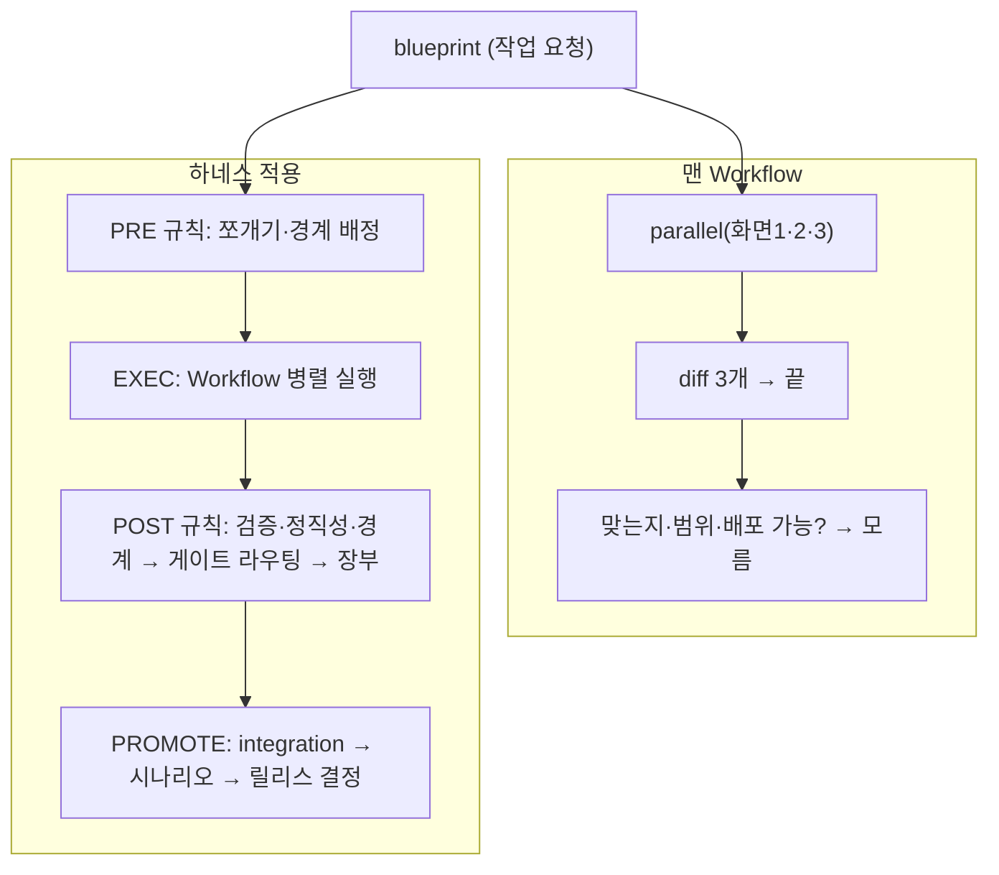

# 02 — 멀티에이전트 생산성: 빠진 조각

> **핵심 한 줄:** 협업 **기반은 이미 60% 깔려 있다.** 없는 건 그 위의
> **디스패치·통합 로직**. 단, 이 문서의 "coordinator 먼저" 추천은 **문서 03에서 뒤집힌다**
> (진짜 병목은 나눠주기가 아니라 사람 검수였으므로). 이 문서는 "조각 목록"으로 읽되,
> 우선순위는 03을 기준으로 삼을 것.

---

## 전제: 긴장 관계

**품질 게이트와 멀티에이전트 병렬성은 서로 당긴다.** Human Gate(승인 전 구현 금지)는
본질적으로 **직렬화 지점**이고, 생산성은 **병렬화**에서 나온다. 그래서 "스킬 몇 개 더"가 아니라
"게이트를 유지하며 어떻게 병렬화하느냐"가 진짜 설계 문제다.

## 가장 중요한 전제조건 — 기반 정보의 완전성 (1차 검토 #3)

> **자율 병렬화는 기반 정보(와 요구사항)가 명확해야 성립한다.**

내 하네스의 Human Gate는 *약점*이 아니라, **SI 프로젝트의 기반 정보·요구사항이 불완전했기에
필수불가결**이었다. 불완전한 정보 위에서 병렬화하면 N개 에이전트가 **같은 모호함을 N번 잘못
넘겨짚는다** — 속도가 아니라 N배의 재작업을 낳는다.

따라서 **"질 → 양(병렬화)"으로 넘어가는 문은 "기반 정보가 명확해졌는가"로 잠겨 있다.**

- 정보가 **명확한 영역** → 병렬화·자율화가 안전(게이트를 사후감사로 내려도 됨).
- 정보가 **모호한 영역** → Human Gate 유지가 옳다(여기선 사람이 병목인 게 정상).

이것이 최상위 결정(문서 00의 "질 vs 양")의 **진짜 판단 기준**이다: 전면 택일이 아니라
**"어느 영역이 정보 완전한가"로 영역별로 나누는** 문제다. (→ 문서 03의 가역성 분류표와 짝)

## 이미 있는 것 (기반 60%)

| 필요한 것 | 내 하네스에 이미 있음 |
|---|---|
| 격리 | `worktree` (WT), sparse-checkout |
| 에이전트 간 통신 | SendMessage/ListAgents, 역할 세션 |
| 요청 추적 | **AG-15 대기 장부**, qa-inbox |
| 생존성 감시 | session-stall-check, patrol 루프 |
| 상태 집계 | pending-status-check |

없는 건 협업 기반이 아니라 그 위의 **디스패치·통합 로직**.

> 쉬운 예로, '자리 안 겹치게(각자 작업 공간) · 서로 말 주고받기(세션 메시지) · 누가 뭘 기다리나(대기 장부) ·
> 멈췄나 감시(순찰)' 같은 **밑바탕은 이미 깔려 있다.** 없는 건 그 위에서 **일을 나눠주고 합치는** 부분이다.

## 빠진 조각 — 어디서 다루나 (지도)

02는 "무엇이 빠졌나"의 **지도**다. 깊은 설계는 아래 문서/백로그가 소유하고, 여기선 **포인터**만 둔다.

| 빠진 조각 | 한 줄 | 설계 위치 |
|---|---|---|
| ① 작업 쪼개기 + 디스패처(coordinator) | 사람이 손으로 나눠줌 → 생산성 천장. blueprint→단위 쪼개기→나눠주기. | **backlog T3** |
| ② 풀 큐 + 작업 락 | 유휴 에이전트가 다음 일 pull, 한 일은 한 명만. 내가 원하던 분업(채택). | 03(제쳐-당김)과 맞물림 |
| ③ 병합·통합 게이트 | N 워크트리 → main 통합. 진짜 비용은 통합 충돌. | **문서 05**(일회용 integration) |
| ④ 의존성 DAG | 평면 큐가 아니라 "A 끝나야 B" 순서. | **backlog T4** |
| ⑤ 게이트 선택적 비동기화 | 저위험·가역=자동승인+사후보고. | **문서 03**(비동기 검수) |

→ ③⑤는 03·05가, ①④는 backlog가 소유. **02 고유는 전제조건(위)·value-add(아래)**뿐이다.

## coordinator vs 실행층: value-add = "그 위의 규칙" (1차 검토 #6)

Claude Code의 **Agent/Workflow는 근육(실행)**을 준다: 서브에이전트 생성, 병렬/파이프라인
fan-out·수집, 워크트리 격리. 즉 **"N개를 어떻게 돌리는가".** 이게 **못 주는 것**이 곧 내 규칙이다:

1. **작업 쪼개기 정책** — 무엇이 *좋은 단위*인가(독립성/검증가능/적정크기). ※기반정보 명확해야 가능(#3).
2. **정직성·검증 규칙** — 각 결과의 "완료"가 진짜인가(verify gate, schema).
3. **경계 규칙** — 각자 자기 레인만(남의 업무규칙·파일 안 건드림).
4. **게이트 라우팅** — 어떤 결과가 사람 승인 필요한가(사전승인 vs 사후감사).
5. **장부 의미론** — 누가 누구를 기다리나, 무엇이 실적인가(AG-15, 이중 마일스톤, 승격 조건).

**예시 — "화면 3개 구현":**
- 맨 Workflow: `parallel([agent(화면1), agent(화면2), agent(화면3)])` → diff 3개. 끝.
  맞는지·범위 넘었는지·배포 가능한지 **모름.**
- 하네스 적용:
  - **PRE(규칙):** 3개가 진짜 독립인가(공통코드 공유 시 그 부분 먼저 직렬화=의존성), 워크트리+sparse 배정.
  - **EXEC:** Workflow가 3개 실행(근육).
  - **POST(규칙):** verify gate + 정직성 체크(주장 vs 증거) + 경계 체크 → 게이트 라우팅 → 장부 기록.
  - **PROMOTE:** 검증+승인된 것만 → integration → 시나리오 → 릴리스 결정.

> **한 문장:** Workflow는 3줄, 하네스는 그 3줄을 **둘러싼 전부.** Agent/Workflow는 10개를 병렬로
> 돌릴 순 있어도, **그 쪼개기가 옳았는지·각 '완료'가 진짜인지·누가 선을 넘었는지·어느 결과를 사람이
> 봐야 하는지**는 못 말한다. 이 4가지에 답하는 게 내 하네스다.

**결론:** 근육은 재발명하지 말고(Workflow 사용), 나는 **신경계+양심(규칙)**에 집중.
차별점(Orca·맨 Workflow 대비)이 정확히 거기라 그게 진입장벽이다.

## 내가 정할 것 (남은 것)

- **우선순위:** 대화 결론은 **03(사람 병목) 우선** — "나눠주기를 자동화해도 사람 검수가 병목이면 소용없다". coordinator는 그다음.
- coordinator 관련 열린 질문(**직접 구현 vs Workflow 실행층**, 범위)은 **backlog T3**에서 추적.
