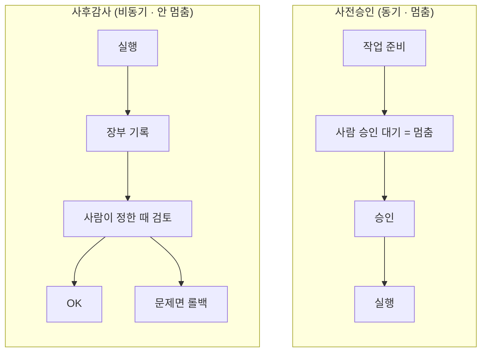

# 03 — 사람 병목과 비동기 검수 루프

> **핵심 한 줄:** AI를 병렬화할수록 사람에게 요구되는 **의사결정 빈도가 올라간다.**
> 진짜 자동화 대상은 AI가 아니라 **사람의 역할 구조** — 동기식 감시자에서 비동기식 검수자로.

---

## 내가 발견한 현상 (실제 현상)

역할별로 에이전트를 분리했지만, **최종 검수자인 사람은 여전히 피곤했다.**
사람이 해결할 병목이 생기면 즉시 대처하려고 모니터를 자주 주시해야 했고,
**"AI의 페이스가 빨라진 만큼 사람의 페이스도 빨라졌다."**

- 에이전트가 N개면 막힘·승인·검수 요청도 N배로 쏟아지고, 사람이 유일한 수렴점이라
  결국 사람이 N배 빨라져야 한다.
- 패트롤·알림을 **잘 만들수록** 오히려 **인터럽트 구동(interrupt-driven)**이 되어
  모니터를 못 떠나게 했다 → 알림을 잘 만들수록 더 못 쉬는 역설.

**따라서 다음 자동화 대상은 AI가 아니라 "사람의 역할 구조"다.**

## 핵심 원리: 동기식 감시자 → 비동기식 검수자

지금 구조의 치명적 속성: **사람이 자리를 비우면 시스템이 멈춘다**(에이전트가 응답을 기다리며 섬).
멈추니 못 떠나고, 못 떠나니 피곤하다. 이걸 깨는 방법 두 개.

> 비유하자면, **사장님이 자리를 비우면 가게가 멈춘다** — 알바생이 답을 기다리며 서 있으니까.
> 멈추니 못 떠나고, 못 떠나니 피곤하다. 그래서 사장님을 **'계속 지켜보는 사람'에서 '정한 때 모아 보는 사람'**으로 바꾼다.

### 방법 A — 막힘을 "정지"가 아니라 "주차"로 (제쳐-당김)
에이전트가 사람 결정을 기다릴 때 **그 자리에서 놀며 서 있으면 안 된다.**
막힌 작업은 **옆으로 치워두고(park) 다음 작업을 집어와(pull)** 계속 일한다.
- 막힘 1건이 에이전트 1대를 멈추지 않음 → 전체 진행은 계속됨
- 진행이 계속되니 사람이 자리를 떠나도 됨 → 사람이 자기 페이스를 되찾음
- 구현: AG-15 장부에 `parked` 상태 + "막히면 다음 걸 pull" 규칙 추가

> 쉬운 예로, 막힌 알바생은 멍하니 서 있지 말고 **옆으로 치워두고 다른 일을 집어** 계속 일한다.
> 그래야 사장님이 자리를 떠나도 가게가 돈다.

### 방법 B — "승인 후 구현" → "구현 후 감사" (가역적 작업 한정)
Human Gate가 피곤한 근본 이유는 **동기식(blocking)**이라서다.
가역·저위험 작업은 뒤집는다:
- **사전승인(동기, 막음)** → **사후감사(비동기, 로그 + 롤백)**
- 에이전트가 먼저 하고 장부에 남김 → 사람은 **자기가 정한 시각**에 로그를 훑고 문제면 되돌림
  (safe-delete·worktree로 롤백 기반은 이미 있음)
- 비가역·업무규칙 관련만 사전승인으로 남기면 **동기 결정 개수 자체가 급감**

> 쉬운 예로, 되돌릴 수 있는 쉬운 일은 **'먼저 하고 → 나중에 보고'**로 뒤집는다.
> 사장님은 꼭 **미리 허락받을 일**(되돌리기 어렵거나 중요한 것)만 실시간으로 본다 — 그러면 실시간 응답이 확 준다.

## 결정 개수/부하를 줄이는 보조 장치

- **배치 리듬:** 실시간 대응 금지. 막힌 결정은 큐에 쌓고 사람이 **정한 간격**(예: 90분)에 일괄 처리.
  사람이 페이스의 주인이 된다.
- **결정 사전소화(pre-digestion):** "대기 중"만 알리지 말고
  **"결정 1줄 + 선택지 2~3개 + 추천 + 영향범위"**를 미리 씹어서 올린다. 사람은 생각이 아니라 선택만.
- **신뢰도 게이팅:** 에이전트가 자기 확신도를 매겨 **저확신만 에스컬레이션**,
  고확신은 진행+사후감사 로그.

## 승격 규격 (실행으로 옮길 때의 계약)

세 조각을 명확하게 나눠 둬서 나중에 그대로 스킬로 옮길 수 있게 한다. (스킬화는 07과 같은 규칙 — 실제로 한 번 써 보고 굳은 뒤.)

- **제쳐-당김(park-pull):** AG-15 장부 항목에 상태 `parked` 추가 + 필드 `막힌사유`·`재개조건`·`park시각`. 규칙: **사람 결정을 기다릴 땐 서 있지 않는다 — park하고 다음 일을 pull한다.** 재개 조건이 채워지거나 사람이 결정하면 다시 큐로 올린다.
- **배치 리듬:** 실시간 대응 금지. 에스컬레이션은 큐에 쌓고 **사람이 정한 간격에 모아** 처리한다(기본 고정, 옵션 적응형). 사람이 페이스의 주인이 된다.
- **결정 사전소화:** 에스컬레이션 항목은 반드시 이 형식 — `결정 1줄 · 선택지 2~3개 · 추천 · 영향범위 · 07 판정(A/B/C/D)`. "대기 중"만 올리는 것은 금지. 사람은 생각이 아니라 **선택**만 한다.

## 하네스 반영 (계획 — 공개판에 없음)

- AG-15에 `parked` 상태 + 제쳐-당김 규칙
- 가역성 분류표(사전승인 vs 사후감사) — **방법 B의 기준선**
  **← [1차 검토 #5] "선택적 비동기 게이트엔 선택 기준이 필요하다" = 바로 이 표.**
  4개 기준(가역성·기반정보·영향범위·업무규칙)의 **정본은 문서 07.**
- qa-inbox를 "읽기 전용 조회"→"일괄 승인/반려 인박스"로 승격
- RL-12(qa-master 위임)을 **위험도 분류**로 확장

## 확정된 결정

- **A·B는 짝 — A를 먼저 깔고 B를 얹는다.** 제쳐-당김(A)이 없으면 "사람이 떠나도 진행"이 성립하지 않으니 A가 전제, 사람 부하를 크게 줄이는 B가 그 위에 온다.
- **배치 리듬 = 고정 간격 기본, 적응형은 선택.** 기본은 사람이 정한 고정 간격(단순·예측가능). 막힌 결정이 임계치를 넘으면 당기는 적응형은 옵션으로 둔다.
- **동기/비동기 판정은 07이 쥔다.** 무엇을 사후감사(B)로 내리고 무엇을 사전승인으로 남길지는 가역성 분류표(07)가 정한다 — 이 문서는 "그래서 사람의 역할을 어떻게 바꾸나"를 맡는다.

## 남은 운영 선택 (쓰면서 정함)

- 적응형 배치의 임계값(막힘 몇 건에서 당길지).
- 내 업무 중 "사후감사로 내려도 되는" 작업 비율 — 높을수록 B 효용이 크다(포팅·리네임·테스트 추가 = 쉽게 내려감 / 업무규칙·화면 정책 = 못 내림). 측정해 조정.
