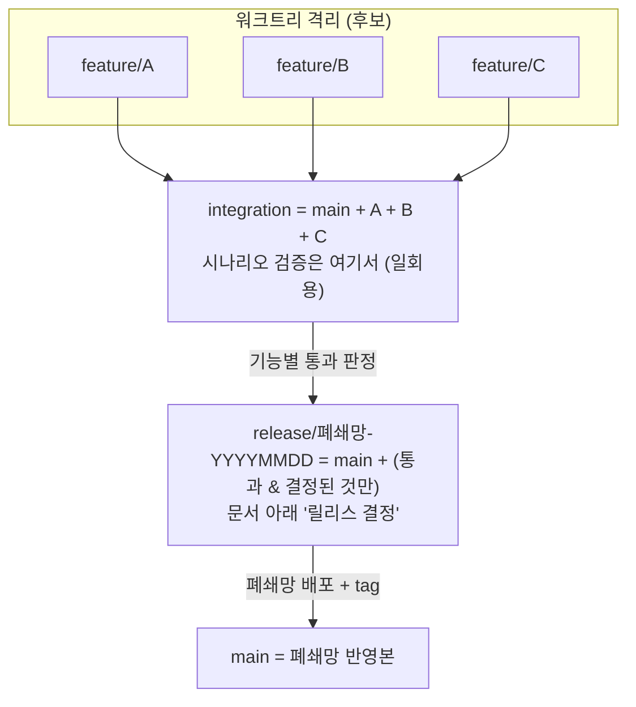
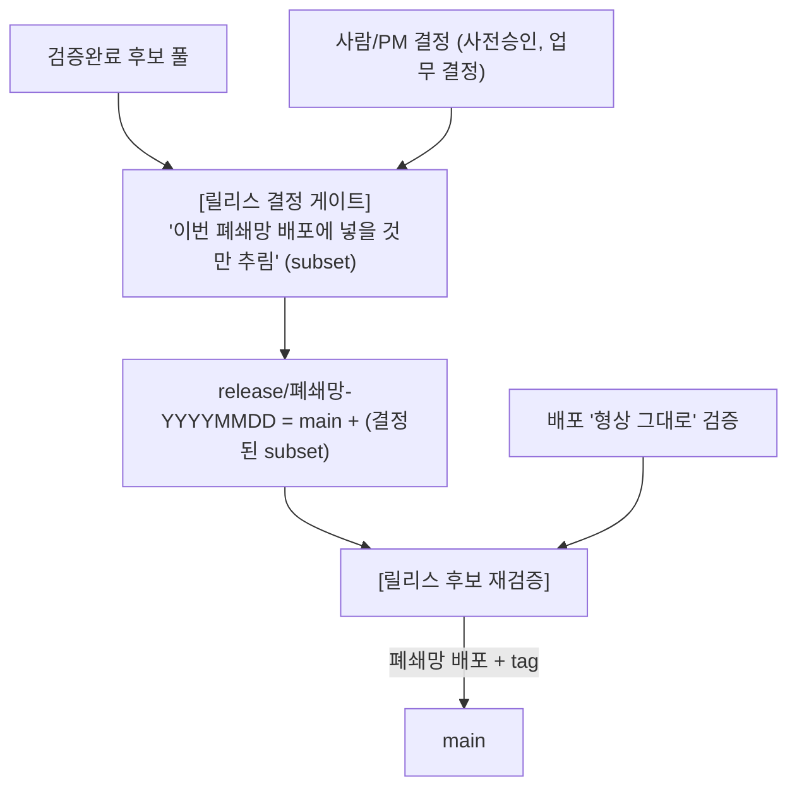

# 05 — 검증·통합·릴리스 결정

> **핵심 한 줄:** 시나리오 검증(E2E)은 본질적으로 **통합을 강제**한다 — 이건 정당하고 불가피.
> 빠져 있던 건 규율이 아니라 **`integration`이라는 브랜치 역할**. 그 역할을 "일회용·재생성 가능"으로
> 두면 "검증하려 다 합쳤다가 main이 오염된" 사고가 구조적으로 사라진다.

---

## 왜 그럴 수밖에 없었나 (내 잘못이 아닌 부분)

"시나리오 검증 단계에서 main에 모두 병합해버렸다."

- 교차 기능 시나리오는 **격리된 feature 브랜치에서 검증 자체가 불가능** — 전체가 합쳐져야 돈다.
- 그래서 "검증하려면 다 합쳐야 한다"는 **정당하고 불가피**했다.
- 진짜 문제는 "합친 것"이 아니라 **합친 장소** — 합칠 **전용 브랜치가 없어서** 유일한 합치는 지점인
  main에서 검증했고, main이 곧 실적/배포 진실이라 검증용 뒤섞임이 "배포된 것처럼" 눌러앉았다.
- 빠져 있던 건 **`integration`이라는 역할**.

## 핵심 원리: 통합 브랜치는 "일회용·재생성 가능"

**`integration`을 성물(sacred)이 아니라 소모품으로** 취급한다.

**사고를 되돌리는 방식:**
- `integration`은 합친 것일 뿐 **진실의 원천이 아님.** 언제든 **버리고 다시 만듦.**
- 시나리오 검증에서 **C가 터지면** → `integration = main + A + B`로 **C만 빼고 다시 합치기.**
  C 작성자는 feature/C에서 고쳐 다음 트레인에 재진입.
- **main도 팀원 기반도 C를 본 적이 없음** → "미완성이 남 작업을 깬다"가 구조적 불가능.
- `검증완료` 마일스톤 = integration에서 시나리오 통과 = 정직한 내부 실적(문서 04).

즉 "전부 main 병합" → **"전부 integration 합치기 → 통과분만 승격(promote)".**
합치기는 똑같이 하되 **합친 것이 일회용**이라 main이 안 더러워진다.

> 쉬운 예로, 전체 맛을 보려면 다 합쳐야 한다. 근데 **임시 작업대**에서 합쳐 맛보고 **통과한 것만** 진짜 상자에 담는다.
> 임시 작업대는 언제든 **치우고 다시 차린다** → 하나 상하면 **그것만 빼고 다시** 차리면 끝.

## 릴리스 결정 단계 (내가 추가 요청한 것)

**검증된 전부가 이번 배포에 들어가는 게 아니다.** 고객/PM이 이번 폐쇄망 배치의 범위를 정한다
(우선순위·정책·고객 준비도·리스크). 그래서 "합친 것 전체"와 "실제 배포 셋"은 **다른 집합**.

두 가지가 중요:
- **결정 게이트는 "자동화하지 말아야 할" 게이트.** 사업·업무 결정이라 Human Gate가 **정당하게** 걸린다
  (문서 03의 제쳐-당김으로 비동기화할 대상이 **아님**). "줄일 결정(저위험·가역)"과
  "남길 결정(릴리스 범위)"을 나누는 바로 그 선.
- **결정 후 반드시 "재검증".** 전체(integration)는 통과했어도, **고른 subset을 main 위에 합친 형상**은
  아직 아무도 안 돌려봤다. 폐쇄망은 **배포 후 핫픽스가 비싸서**, 배포할 형상 그대로 한 번 더 검증해야
  "A는 넣고 B는 뺐더니 깨짐"을 막는다. air-gap 환경의 필수 보증.

> 비유하자면, 검증된 걸 **전부** 손님상에 내는 게 아니라 '이번엔 이것만' **사장님이 고른다**.
> 고른 다음엔 **한 번 더 확인** — 손님상은 **한 번 나가면 무르기 어려우니까.**

→ 합치기가 **두 번, 목적이 다르게**: `integration`=버그 찾는 합치기(전부),
`release`=배포하는 합치기(고른 것만). 둘 다 일회용.

## 맹점 — 얽힌 변경은 콕 집어낼 수 없다 (2차 검토)

위 모델은 **"C를 콕 집어 뺄 수 있다"**를 전제한다. **변경이 겹치면 이 전제가 깨진다.**

> 쉬운 예로, C를 당장 내야 하는데 B가 **모두 쓰는 재료(공유 로직)**를 바꿔버렸고 **C도 그 재료를 쓴다** →
> '**C만**'이 아니라 '**C + B가 바꾼 재료**'가 돼서 쏙 빼낼 수가 없다.

**실제 사례:** C를 당장 배포해야 하는데, B 작업 중 발견된 모순 때문에 **여러 클래스가 의존하는 공유 로직을
B가 전면 수정**했고, **C도 그 로직에 의존**한다. → **C는 더 이상 B와 독립이 아니다.** "C만 배포"가
실은 "C + B의 공유수정"이 된다. cherry-pick은 **진짜 의존성은 못 자른다.**
(일회용 합치기 모델은 "기능 하나 빼기"는 풀어도 "의존하는 미배포 기능 위의 기능을 혼자 내보내기"는 못 푼다.)

**근본 원인:** B의 공유 수정이 **"B"라는 기능 안에 파묻혀 자기 신분이 없었던 것.** 공유 수정은 여러 기능의
**기반**인데 한 기능에 묻히면 그 기능과 운명을 같이한다. = **의존성 관리 실패.**

**치료 — 모 아니면 도가 아니라 "스펙트럼" (2차 검토 보강)**

3가지(①함께 ②back-fill ③떼어먼저)는 **굵은 덩어리**였다. 얽힘은 실제론 **연속적**이라, 완전 해소를
노리고 3개 중 하나를 고르려다 **그 고민 자체가 병목**이 된다. 그래서 ⑴결과를 **스펙트럼**으로 넓히고,
⑵선택을 **측정 가능한 질문**으로 바꾼다. **전제: 목표는 "깨끗한 승리"가 아니라 최소 비용 경로를 빨리 고르고
잔여 부채를 명시하는 것.**

**결과 스펙트럼 (싼 것 → 비싼 것)**

| | 경로 | 언제 |
|---|---|---|
| O1 | **함께 배포**(C+X) | X가 지금 배포 가능 |
| O2 | **플래그 격리 부분배포** — X를 켜되 **C 경로만** 새 로직 | X에 토글 주입 가능 |
| O3 | **shim/어댑터** — C가 옛 X 위에서 **새 시그니처만 흉내** | C가 X의 *존재*만 필요 |
| O4 | **부분 추출** — X 중 **C가 쓰는 부분만** 떼어 먼저 배포 | 겹침이 작게 닫힘 |
| O5 | **전체 떼어 먼저**(원래 ③) | X 통째 배포 가능 → **기본값** |
| O6 | **back-fill**(원래 ②) + 화해 부채 | X를 **전혀** 못 내보냄 |

O2·O3·O4가 "모 아니면 도"를 깨는 **중간 길**이다.

**정할 것 — 구체 질문 5개 (대부분 기계적 측정, 감으로 토론 금지)**

- **Q1. X는 지금 그 자체로 배포 가능한가?** — 측정: X 변경 파일만 main 위에 올려 **독립 verify 게이트**
  통과 Y/N *(자동)*. → **Y: O1·O5 열림 / N: O1·O5 막힘 → O6.**
- **Q2. C는 X의 "새 동작"이 필요한가, "존재"만 필요한가?** — 측정: C가 쓰는 X 심볼이 **고친 새 로직에
  의존**하는지 호출부별 *(목록화 자동, 성격은 리뷰)*. → **새 동작: O3 불가·O6는 수정복제로 비싸짐→O4/O5
  / 존재만: O3(shim) 저렴.**
- **Q3. C가 X에 닿는 표면적이 얼마나 좁은가?** — 측정: **C→X 호출부·겹치는 심볼 수** *(자동 집계)*.
  → **좁음: O6·O4 싸다 / 넓음: O5.**
- **Q4. X의 새 동작을 플래그·분기로 격리 가능한가?** — 측정: X가 **토글 주입 가능한 구조**인가 *(구조점검)*.
  → **가능: O2.**
- **Q5. 겹침의 여파 범위가 작게 닫히나, 번지나?** — 측정: **X 의존자의 여파 범위(간접까지 닿는 전부) ∩ C가 건드리는 집합**
  크기 *(그래프 자동계산)*. → **닫힘: O4·O6 가능 / 번짐: O6 위험→O5.**

**병목 방지 3장치**
1. **측정 대부분 자동**(Q1·Q3·Q5) → 수치가 경로를 정함, 토론 최소화.
2. **기본값:** 애매하면 **O5**(통째 떼어 먼저 — 근본 수정·최다 재사용). 단 **Q1=N이면 O6+부채기록**이 기본값.
3. **시간 상한:** 결정에 상한(예: 30분). 넘으면 **기본값 강제 진행 + "차선 선택, 추후 재검토" 장부 기록.**

**왜 O5가 기본값인가:** 공유 로직 수정은 **원래 자기 배포 단위**였어야 한다(여러 기능의 기반). B가 발견했을
뿐 "B 소유"가 아니고, 모순을 고친 **correctness 수정이라 어차피 배포될 것**. 떼어 먼저 배포하면 C의 의존이
"B"가 아니라 **"공유수정 단위"**가 되어 명시적·배포 가능 — **근본 원인까지 고침.** O6(back-fill)는 X를 전혀
못 낼 때의 정당한 응급처치지만, 공유 로직 **두 버전**이 생기므로 **"B 배포 때 화해"를 장부에 반드시 기록.**

**새로 넣을 규칙 3개**
1. **릴리스 결정 = "분리 가능성(여파 범위) 검사".** 이름만 고르지 말고, C의 변경이 **결정에서 빠진 항목과
   같은 파일/심볼을 건드리는지 자동 판정**(문서 07의 ③ 영향범위 자동판정을 "항목 간 겹침"으로 확장).
   못 자르면 **자동 플래그** → 위 3가지 중 사람이 선택(사전승인).
2. **공유·기반 로직 변경은 자체 배포 단위로 승격 + 사전승인(거부권).** "N개 클래스가 의존하는 로직을
   건드림"을 **일찍 탐지**해 기능에서 떼어낸다 → 얽힘 **예방**(③을 기본값으로).
3. **②를 택하면 "분리 부채" 장부 기록** — "C는 옛 공유로직 위에서 배포됨, B 배포 시 화해 필요"(문서 04 장부에 얹음).

**git-deploy-extractor와의 관계:** 추출기는 **파일을 통째로** 꺼낸다. B와 C가 같은 파일을 건드렸으면
그 파일은 하나라 **추출 단계에선 절대 못 가른다.** → **분리는 "소스/의존성 단계"에서 끝나야 한다.**
그래서 feature를 **main(배포본) 기준**으로 두면 겹침은 **"진짜 의존성"일 때만** 생기고, 그건 위 ①②③으로 명시 처리한다.

> **솔직한 한계:** 모델이 얽힘을 **공짜로 풀진 못한다.** 할 수 있는 건 ⑴마감 때 터지지 말고 **일찍 탐지**,
> ⑵공유 변경에 **독립 신분 부여**(예방), ⑶비용을 **보이게·선택하게·기록.**
> "감수"는 맞다 — 하네스는 그 감수를 **기습이 아니라 미리 보이고 고르게** 만든다.

## 폐쇄망 배포 추출 메커니즘 (1차 검토 #7 — 실제 사례)

릴리스 결정 → 재검증 다음의 **"폐쇄망으로 무엇을 어떻게 꺼내느냐"** 단계. 여기에 실제 겪은 함정과
내가 만든 대체 도구가 있다.

**AA팀 배포 도구의 결함 — 커밋 diff 기준 추출**
- 변경사항을 **커밋 해시 기준**으로 추출하는데, 여러 커밋을 선택해도 **tip(최근) 해시 하나의 diff만** 뽑는다.
- 예: `12345`에 `Asdf.java`, `23456`(최근)에 `Zxcv.java` 변경. 둘 다 선택해도 **`23456`의 `Zxcv.java`만**
  추출되고 `Asdf.java`는 **유실**.
- 결과: **적시에 동기화하지 않으면 무의미** — 배치 배포가 위험하고, 위험한 타이밍을 강제한다.
  (이 압박이 "실적 보이려 main에 조기 병합"과 같은 뿌리의 문제를 키운다.)

**나의 대체품 — git-deploy-extractor (파일 스냅샷 추출)**
- 선택한 **브랜치&커밋에 포함된 파일 자체**를 추출(diff가 아니라 스냅샷) → **유실 없음. 올바른 기본 단위.**
- 전제: 타팀/타인이 **적기에 본인 소스를 폐쇄망에 배포**했을 것.

**브랜치 모델과의 맞물림 — 모델을 검증하고 완성한다:**
1. "커밋 diff 추출"의 취약성이 근본 문제. 모델의 답: 커밋 diff가 아니라
   **합친 상태(`release` 브랜치 = main + 결정 subset)의 파일 집합**을 추출 → git-deploy-extractor가
   **정확히 이 방식**.
2. "타인이 적기에 배포" 전제 = 협업 의존. 모델에서 **main = 폐쇄망 반영본**으로 두면
   *"타인 코드가 폐쇄망에 있다" ⟺ "main에 있다"*가 되어 **베이스가 구조적으로 보장** → 취약한 전제를 **제거**.
3. 교차 의존(내 파일이 아직 미배포인 남 코드 필요)은 **릴리스 후보 재검증(위)**이 배포 전에 잡는다.

> **결론:** AA 도구 → git-deploy-extractor = **도구 수정**, 브랜치 모델 = **프로세스 수정.**
> 둘이 합쳐지면 폐쇄망 배포가 *"적기면 맞음(correct-if-timely)"* → **"구조적으로 맞음
> (correct-by-construction)"**으로 바뀐다.

**범용본 관점:** git-deploy-extractor의 "파일셋 추출"은 air-gap/스냅샷 배포의 **범용 기본 단위**라
환경값이 아니라 **핵심(불변)** 쪽에 가깝다(문서 06). 실제로 만든 산출물이라 **포트폴리오 증거**로도 강하다.

## 하네스 반영

- **scenario-verify 파이프라인**을 "main 대상"이 아니라 **"integration(일회용 합친 것) 대상"**으로 고정.
- **git-deploy-extractor**를 릴리스 트레인의 배포 추출 단계 도구로 편입(파일 스냅샷 기준).
- **AR/BR: 승격(promote)은 시나리오 통과가 조건.** 개발자의 "병합하고 싶다"가 아니라 **검증 결과**가 결정.
- **통합 게이트**(문서 02의 #3)가 "integration 다시 합치기 + 시나리오 통과 → release 승격"의 자동화 몸통.
- **릴리스 결정 게이트** + **릴리스 후보 재검증** 규칙 신설.

## 전체 흐름 (요약)

> 격리(worktree) → 일회용 합치기(integration) → 시나리오 검증 → **릴리스 결정(사람)** →
> 재검증(배포 형상) → 폐쇄망 배포 = main.
> 사람은 이 흐름을 **비동기로 검수**(문서 03), 합치기·검증·승격은 **통합 게이트가 자동화**.

## 제안 — 04가 정해지니 이것도 정리된다 (2차 검토)

**`main` = "손님상에 나간 것만"**이 확정됐으니(문서 04), 남은 열린 질문들에 자연스러운 답이 나온다.
새 개념이 아니라 **이미 정의된 것들의 조합**이라, 04가 닫히니 05도 추가 설계 없이 정리됨.

**① integration: 통째 다시 합치기 vs 하나씩 승격 → "기본 통째 + 공유 로직만 하나씩 먼저"**
- feature는 **main(배포본) 기준**으로 격리 → 평소엔 **통째 다시 합치기**으로 전체 맛보기
  (폐쇄망 배치 리듬과 일관, 일회용 철학과 일치).
- 단 **공유·기반 로직을 건드리는 변경만은 하나씩 먼저 승격**(머지 큐) → 얽힘을 **조기 발견**
  (위 맹점 "규칙 2"와 같은 손). 즉 양자택일이 아니라 **변경 성격으로 분기**: 일반 기능=통째, 공유 로직=하나씩.

**② 재검증(=식당 주방 검수) 범위 → "변경 + 여파 범위 + 손님상 기본 한 바퀴"**
- 식당 주방 검수는 **의무**(문서 04)지만 전수 재검증은 느리다. 중간을 택한다:
  - **항상:** 손님상에 나가는 **기본 한 바퀴**(정상 흐름 빠른 확인 — 최소 안전망)
  - **집중:** **바뀐 부분 + 그게 닿는 여파 범위**(위 맹점 **Q5 재사용**) 시나리오
- "전수(안전·느림)"와 "변경만(빠름·위험)"의 중간이자, **이미 정의한 여파 범위 계산을 재활용**한다.

> 두 제안 모두 **통째/머지큐·여파 범위 계산·식당 검수**라는 기존 조각의 조합이다.

## 내가 정할 것 (남은 것)

- **릴리스 결정 게이트의 입력을 무엇으로?** 검증완료 후보 풀 목록 + 각 항목의 우선순위/리스크.
  (이 목록을 pending-status-check류 장부에서 자동 생성할 수 있다.)
- **이 파이프라인을 규칙(문서)으로만 둘까, scenario-verify 스킬로 실행까지 만들까?**
