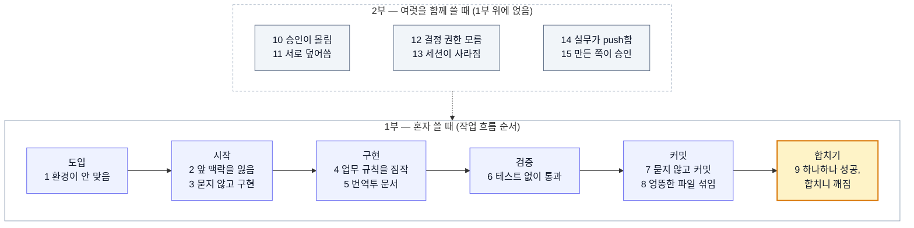

# 어떤 상황에서 이 하네스가 유용할까?

> 초안(2026-11-20). 이 가이드북은 개념 순서가 아니라 **겪은 문제 순서**로 짜여 있다.
> 아래 흐름도와 표에서 지금 겪는 문제와 가장 가까운 줄을 찾아 그 장만 읽으면 된다.

## 읽는 법

- **1부 — 혼자 쓸 때:** AI 세션 하나와 일할 때 겪는 문제. 하네스 0.1.x 규율만 있으면 된다.
- **2부 — 여럿을 함께 쓸 때:** 사람이 AI 세션 여러 개를 엮어 함께 쓸 때 겪는 문제. 각 세션이 1부 규율을 지키고 있다는 전제 위에 얹는다(0.2.0).
- 장마다 같은 순서로 쓴다: **문제 → 해결책 후보 → 선택 제안.** 필요한 장에만 "해 보기"와 "확인"을 붙인다.
- 낯선 말은 맨 아래 용어집 후보에 모았다.

## 한눈에 보기

문제가 작업 흐름의 어디쯤에서 생기는지 보여 준다. 번호를 아래 표에서 찾아 들어가면 된다.

## 1부 — 혼자 쓸 때

작업이 흘러가는 순서(도입 → 시작 → 구현 → 검증 → 커밋 → 합치기)대로 번호를 매겼다.

| # | 겪는 문제 | 하네스가 권하는 길 (한 줄) | 정본 |
|---|---|---|---|
| 1 | 하네스 규칙이 우리 팀 환경(경로·스택·OS)과 안 맞는다 | 규칙은 그대로 두고, 환경값만 우리 것으로 바꿔 읽는다 | `docs/환경값-정의.md`, `design-notes/06` |
| 2 | 새 세션을 열면 앞 맥락을 잃고 같은 걸 또 묻는다 | 세션마다 이름을 붙이고, 그 이름의 인계 문서(`<세션명>.md`)를 정해진 곳에 둔다. 새 세션은 자기 이름의 문서부터 읽는다 | `rules/` 8단계(AR-13) |
| 3 | AI가 묻지도 않고 바로 구현해 엉뚱한 걸 만들었다 | 청사진(작업 계획)을 먼저 쓰고, 사람이 승인한 뒤에만 구현한다 | `rules/` 3·4단계(RQ, GT-02), `skills/dlc-gate` |
| 4 | AI가 업무 규칙이나 기획 의도를 짐작해서 채웠다 | 근거로 정해지는 건 적용하고, 아닌 건 후보안을 붙여 묻게 한다 | `rules/` 1단계(GL-16~19), 3단계(RQ-05) |
| 5 | AI가 쓴 문서가 번역투·과장·이모지투성이다 | 서술 규칙을 두고, 커밋 전에 린터로 기계 점검한다 | `skills/seosul-lint`, `rules/` 1단계(GL-29), `design-notes/08` |
| 6 | "테스트 다 통과"라는데 실제로는 테스트를 실행해 보지 않았다 | 검증하지 못한 건 못 했다고 쓰게 한다. 못 돌린 경우도 기록한다 | `rules/` 1단계(GL-20, GL-25), 10단계(TS-07) |
| 7 | [AI가 묻지도 않고 커밋·삭제·강제 push를 했다](./07-묻지않고-커밋삭제.md) | 되돌릴 수 있는지로 "혼자 해도 되나, 멈추고 물어야 하나"를 판정한다. 한 기준만 걸려도 멈춘다 | `design-notes/07`, `skills/reversibility-gate`, `examples/reversibility_demo.py`, `skills/safe-delete` |
| 8 | 커밋에 엉뚱한 파일이 섞여 들어갔다 | 커밋마다 계획(브랜치·파일·메시지)을 승인받고, 스테이징을 계획과 대조한다 | `rules/` 11단계(CS-01~) |
| 9 | [작업 하나하나는 성공했는데 합치니 깨졌다](./09-합치니-깨짐.md) | 병합한 코드 전체를 다시 테스트한다. 병합은 버리고 다시 만들 수 있는 통합 브랜치에서 하고, 새 맥락의 검증자가 한 번 더 확인한다 | `design-notes/05`, `design-notes/04`, `rules/` 7단계(BR-05), `skills/dlc-gate`, `examples/merge_break_demo.sh` |

9번이 이 하네스의 한 방이다. 에이전트 하나하나의 성공이 아니라 **전체 정합성**을 확인한다.

## 2부 — 여럿을 함께 쓸 때

| # | 겪는 문제 | 하네스가 권하는 길 (한 줄) | 정본 |
|---|---|---|---|
| 10 | AI를 여럿 쓰니 사람이 승인하느라 더 바빠졌다 | 사람은 지켜보는 쪽이 아니라 모아서 검수하는 쪽으로 간다. 되돌릴 수 있는 게이트는 좁게 위임한다 | `design-notes/03`, `docs/오케스트레이션-구성.md`(선택: 좁은 위임) |
| 11 | 세션끼리 같은 파일·브랜치를 건드려 서로 덮었다 | 역할을 가르고, 실무 세션마다 브랜치와 워크트리를 따로 준다 | `docs/오케스트레이션-구성.md` 1·3걸음, `rules/` 12단계(WT), `skills/worktree` |
| 12 | 누가 무슨 권한으로 결정했는지 나중에 알 수 없다 | 사람이 넘긴 것과 넘기지 않은 것을 위임기록에 적는다 | `docs/위임기록-템플릿.md` |
| 13 | 실무 세션이 조용히 사라졌거나 멈춰 있었다 | 지시를 보내기 전에 상태를 보고, 꺼져 있으면 깨운 뒤 보낸다 | `skills/session-stall-check`, `skills/session-wake`, `design-notes/10` E-6 |
| 14 | 실무 세션이 push·병합까지 해 버렸다 | 금지 도구 목록 대신 플랫폼 장치를 쓴다: 브랜치 보호, 실무 세션 인증에 push 권한 안 주기 | `docs/오케스트레이션-구성.md` 3·4걸음, `rules/` 12단계(WT-09) |
| 15 | 여럿이 낸 결과를 같은 세션이 승인한다(자기 채점) | 만든 쪽이 승인하지 않는다. 승인 뒤에는 새 맥락의 세션이 다시 검증한다 | `design-notes/10` 부록 B~D |

## 먼저 쓸 장 (제안)

- 1부: **7**(실행 데모가 이미 있음) · **9**(한 방) · **6**(가장 흔한 문제)
- 2부: **10**(2부를 여는 이유가 되는 문제)

## 용어집 후보 (정의는 다음 단계)

청사진 · 게이트(Human Gate) · 승인 · 가역성 · 거부권 · 통합 브랜치 · 재검증 · 환경값 · 규칙 ID(GL·CS·WT 등) · 게이트웨이 · 실무자(워커) · 위임기록 · 개밥(실전 검증)
